[Data and summaries](index.qmd) · [Comparisons](compare.qmd) · [How to use](use.qmd) · [Methods](report/methods.qmd) · [Downloads](downloads.qmd) · [Sources](sources.qmd)

```{r}
#| label: setup
source(file.path("report", "_setup.R"))
G <- cat_tbl("Ground_data"); M <- cat_tbl("Maps"); S <- cat_tbl("Studies"); A <- cat_tbl("Assets")
O <- cat_tbl("Other_sources"); C <- cat_tbl("Covariates"); L <- cat_tbl("Study_ground")
xw <- crosswalk |> select(record_id, domain, data_type, ecosystem)
period <- S |> select(study_id, temporal_context)
dom_label <- c(forests = "Forests", soils = "Soils", both = "Forests and soils")
access_label <- function(status) c(Hosted = "Project GEE", `External asset` = "Public GEE")[status] %|% "Provider"
```

A catalogue of forest and soil carbon observations, covariates and maps for Canada. These pages show what the data contain, how selected products compare and the tools available to explore them.

These previews use a separate 2nd–98th percentile colour range for each product. Equal colours across previews do not imply equal values. Grey is no data.

{width=400}

## Catalogue {#find}

<details>
<summary>Open the full dataset catalogue</summary>


```{r}
#| label: find-table
find <- bind_rows(
  G |> transmute(record_id = ground_id, Name = resource_name, Quantity = carbon_pool_or_measurement, Coverage = geographic_coverage,
                 Support = observation_support, `Depth / pool` = depth_support, url = source_url,
                 Access = ifelse(record_status == "Hosted", "Project GEE; provider", access_route)),
  M |> transmute(record_id = map_id, Name = product_name, Quantity = paste0(carbon_pool_or_quantity, " (", source_units_and_scaling, ")"),
                 Coverage = geographic_coverage, Support = ifelse(is.na(reported_output_grid_m), "–", paste(reported_output_grid_m, "m grid")),
                 `Depth / pool` = depth_support, url = source_url, Access = access_label(record_status)),
  O |> transmute(record_id = other_source_id, Name = resource_name, Quantity = depth_or_pool, Coverage = geographic_context,
                 Support = spatial_support, `Depth / pool` = depth_or_pool, url = source_url, Access = access_status)
) |>
  left_join(xw, by = "record_id") |>
  transmute(Name = ifelse(is.na(url), htmlEscape(Name), sprintf("<a href='%s' target='_blank' rel='noopener'>%s</a>", url, htmlEscape(Name))),
            `Forests / soils` = dom_label[domain], `Data type` = tools::toTitleCase(data_type), Ecosystem = ecosystem,
            Quantity, Coverage, Support, `Depth / pool`, Access)
kable(find, escape = FALSE)
```

</details>

# Forests {#forests}

## Ground data {#forests-ground}

Forest plots and sampled-tree datasets are linked below. Plot measurements have not yet been ingested for visual summaries.

<details>
<summary>Forest ground data, study roles and access</summary>


```{r}
fg <- G |> filter(in_domain(ground_id, "forests"))
roles <- L |> left_join(S |> select(study_id, study_name), by = "study_id") |>
  group_by(ground_id) |> summarise(roles = paste0(study_name, " (", study_role, ")", collapse = "; "), .groups = "drop")
fg |> transmute(Dataset = resource_name, Measures = carbon_pool_or_measurement, Coverage = geographic_coverage,
                `Plot support` = na_dash(observation_support), Access = link_md(source_url, na_dash(access_route)),
                `Use and limitations` = first_sentence(considerations)) |>
  kable()
```


```{r}
fg |> left_join(roles, by = "ground_id") |>
  transmute(Dataset = resource_name, `Used by (role)` = na_dash(roles), Licence = na_dash(licence_note), `Catalogue status` = record_status) |> kable()
```

</details>

## Covariates {#forests-covariates}

Environmental and remote sensing inputs include canopy height, reflectance, radar, climate and terrain. Canopy height is shown as an example; correlation does not establish causation.

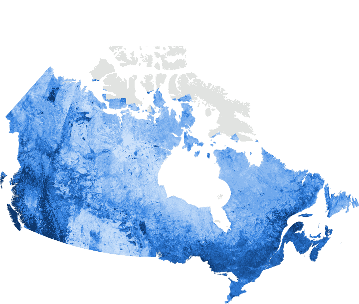{width=650}

<details>
<summary>Forest covariate studies</summary>


```{r}
cov_summary <- function(ids) {
  C |> filter(study_id %in% ids) |>
    group_by(study_id) |>
    summarise(Families = paste(sort(unique(family)), collapse = ", "),
              grids = list(suppressWarnings(as.numeric(native_grid_m))),
              Periods = paste(head(unique(na.omit(temporal_window)), 3), collapse = "; "),
              `Evidence recorded` = paste(names(sort(table(evidence_level), decreasing = TRUE)), collapse = ", "), .groups = "drop") |>
    mutate(`Source grids (m)` = vapply(grids, function(g) if (all(is.na(g))) "–" else paste(fmt_n(min(g, na.rm = TRUE)), "–", fmt_n(max(g, na.rm = TRUE))), "")) |>
    left_join(S |> select(study_id, study_name, output_grid_m), by = "study_id") |>
    transmute(Study = coalesce(study_name, study_id), `Output grid (m)` = na_dash(output_grid_m), Families, `Source grids (m)`,
              Periods = na_dash(Periods), `Evidence recorded`)
}
cov_summary(S$study_id[in_domain(S$study_id, "forests")]) |> kable()
```

</details>

<details>
<summary>All forest covariate entries</summary>


```{r}
C |> filter(in_domain(study_id, "forests")) |>
  transmute(Study = study_id, Variable = feature_name, Family = family, `Native grid (m)` = native_grid_m, Period = temporal_window,
            Source = source_asset_or_product, Evidence = evidence_level) |>
  kable()
```

</details>

## Maps {#forests-maps}


{width=650}

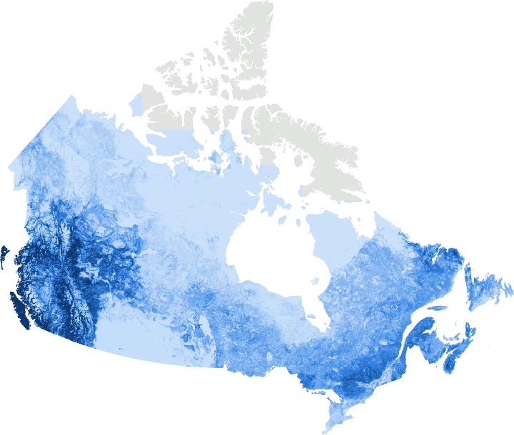{width=650}

{width=650}

<details>
<summary>Forest map products</summary>


```{r}
map_records <- function(dom) {
  M |> filter(in_domain(map_id, dom)) |> left_join(period, by = "study_id") |>
    transmute(map_id, Product = product_name, Quantity = paste0(carbon_pool_or_quantity, " (", source_units_and_scaling, ")"),
              Coverage = geographic_coverage, `Grid (m)` = na_dash(reported_output_grid_m), `Depth / pool` = depth_support,
              Period = na_dash(temporal_context), Access = link_md(source_url, access_label(record_status)),
              `Use and limitations` = first_sentence(considerations))
}
map_records("forests") |> select(-map_id) |> kable()
```

</details>

<details>
<summary>Forest map assets and uncertainty bands</summary>


```{r}
A |> filter(resource_id %in% M$map_id[in_domain(M$map_id, "forests")]) |>
  transmute(Resource = resource_id, Asset = project_or_current_asset, `Bands / schema` = bands_or_schema, `Nominal scale (m)` = nominal_scale_m,
            Units = units_note, `Public read` = public_read_status) |> kable()
```

</details>

# Soils {#soils}

## Ground data {#soils-ground}

Five prepared profile and core datasets. Records are not deduplicated across sources, and some extend beyond Canada.

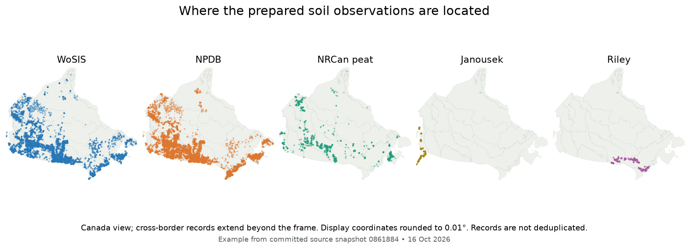

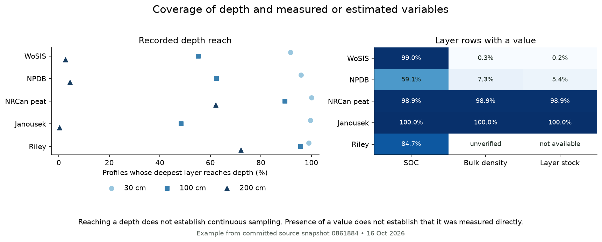

<details>
<summary>Soil profile counts, dates and measurement availability</summary>


```{r}
profile_summary |>
  transmute(Dataset = dataset, `Profiles / layers` = paste(fmt_n(profiles), "/", fmt_n(layers)),
            Dates = ifelse(is.na(year_min), "Not recorded", paste0(year_min, "–", year_max, " (", fmt_n(profiles_dated), " dated)")),
            `Recorded depth` = paste0("median ", fmt_n(median_deepest_layer_cm), " cm; ", percent(share_reaching_100cm, 1), " reach 1 m"),
            `SOC / density / stock in layers` = paste(percent(layers_with_soc, 1), ifelse(is.na(layers_with_bd), "not used", percent(layers_with_bd, 1)),
                                                       ifelse(is.na(layers_with_stock_value), "–", percent(layers_with_stock_value, 1)), sep = " / "),
            `Depth datum` = depth_datum, Qualifiers = qualifiers) |>
  kable(caption = "Share of layer rows with a value; values may be measured or estimated (see qualifiers).")
```

</details>

<details>
<summary>Additional soil ground datasets and access</summary>


```{r}
G |> filter(in_domain(ground_id, "soils"), record_status != "Hosted") |>
  transmute(Dataset = resource_name, Measures = carbon_pool_or_measurement, Coverage = geographic_coverage,
            `Sites / profiles` = na_dash(profile_or_site_count), `Depth support` = na_dash(depth_support),
            Access = link_md(source_url, na_dash(access_route))) |>
  kable(caption = "Further soil observation datasets, available from their providers (not hosted by this project).")
```

</details>

### SOC and bulk density by depth

Mineral-surface and profile-surface depths are kept separate. SOC is in g/kg and density in g/cm³; Riley density is excluded because its units remain unverified.

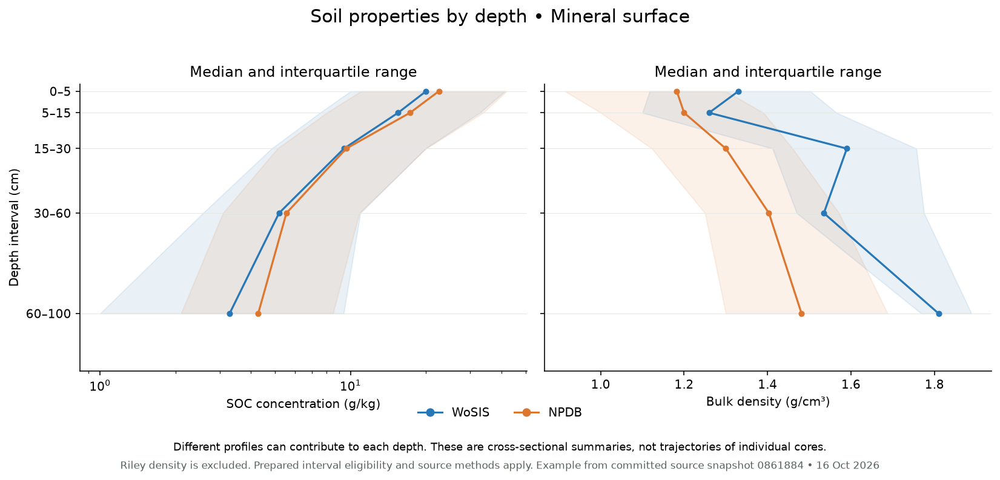

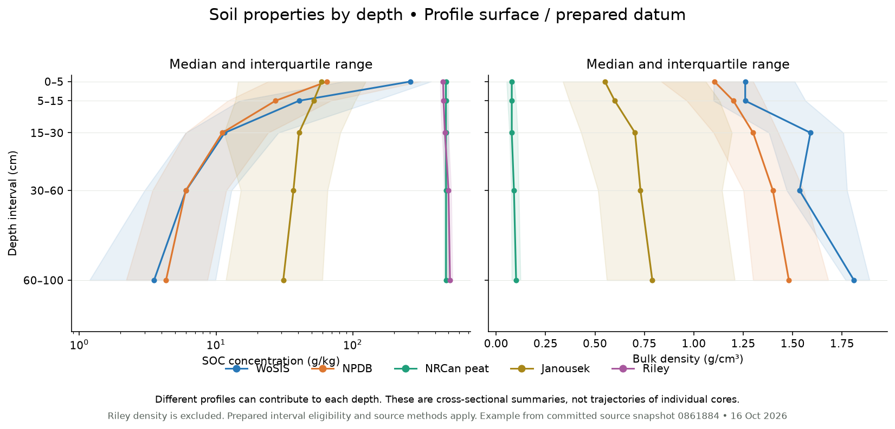

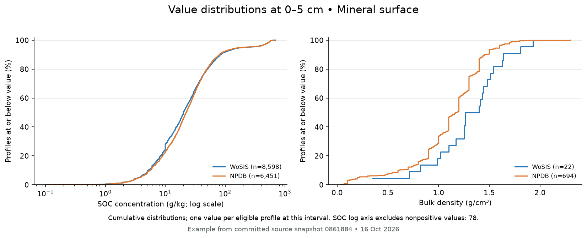

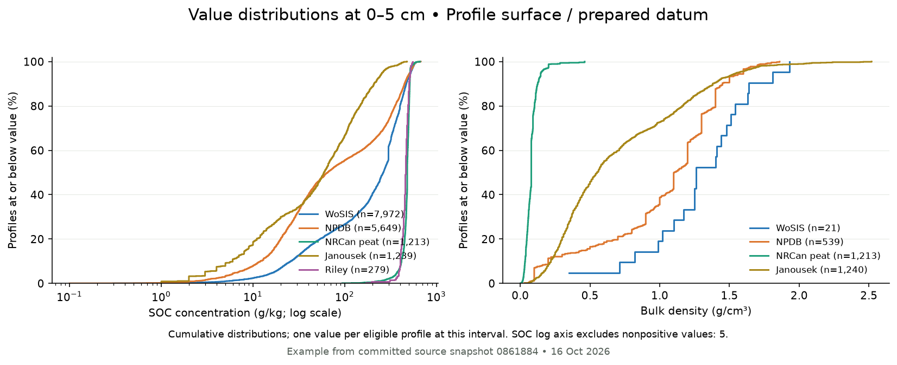

### Stocks at sites

Carbon per unit area at sites, not regional totals. Only prepared eligible intervals are included; boxplots hide outliers and show sample counts.


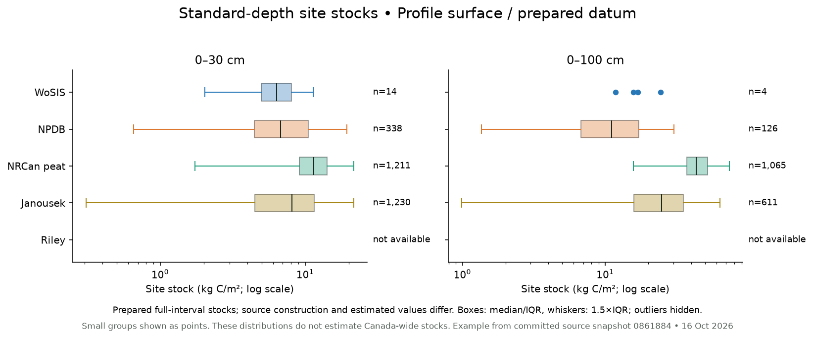

## Covariates {#soils-covariates}

Soil and peat studies use climate, terrain, vegetation, geology and depth. Source-variable maps and distributions have not yet been prepared.

<details>
<summary>Soil and peat covariate studies</summary>


```{r}
cov_summary(S$study_id[in_domain(S$study_id, "soils")]) |> kable()
```

</details>

## Maps {#soils-maps}

Concentration, fixed-depth stocks, peat thickness and full-column peat stocks are separate quantities. Each preview has its own colour range, using the key above.

{width=650}

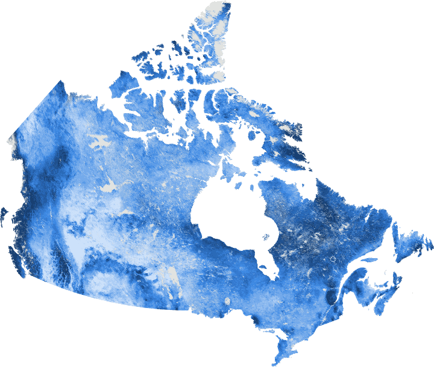{width=650}

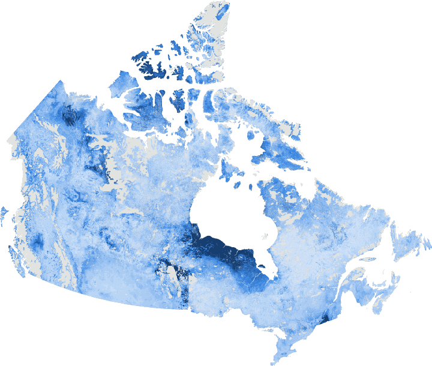{width=650}

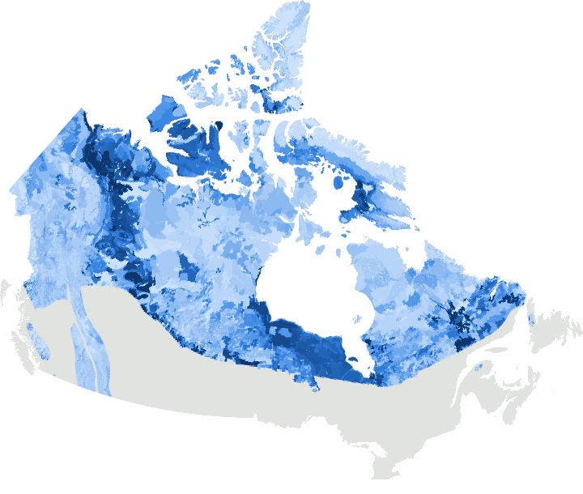{width=650}

{width=650}

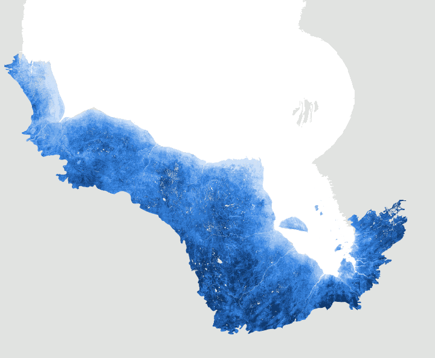{width=650}

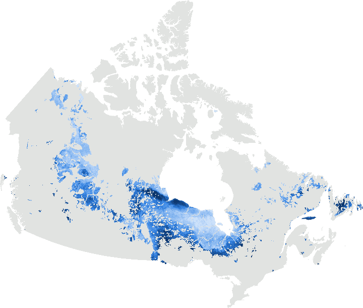{width=650}

<details>
<summary>Soil and peat map products</summary>


```{r}
map_records("soils") |> select(-map_id) |> kable()
```

</details>

<details>
<summary>Soil map assets and uncertainty bands</summary>


```{r}
A |> filter(resource_id %in% M$map_id[in_domain(M$map_id, "soils")]) |>
  transmute(Resource = resource_id, Asset = project_or_current_asset, `Bands / schema` = bands_or_schema, `Nominal scale (m)` = nominal_scale_m,
            Units = units_note, `Public read` = public_read_status) |> kable()
```

</details>

## Further resources {#further}

<details>
<summary>Other catalogued resources</summary>


```{r}
O |> left_join(xw, by = c("other_source_id" = "record_id")) |>
  transmute(Resource = resource_name, `Forests / soils` = dom_label[domain], Category = category, Context = geographic_context,
            Support = spatial_support, `Depth / pool` = depth_or_pool, Access = link_md(source_url, na_dash(access_status))) |> kable()
```

</details>
