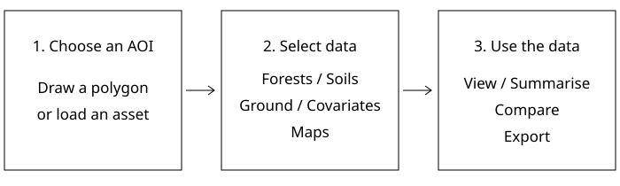

[Data and summaries](index.qmd) · [Comparisons](compare.qmd) · [How to use](use.qmd) · [Methods](report/methods.qmd) · [Downloads](downloads.qmd) · [Sources](sources.qmd)

The **Carbon Data Explorer** is an Earth Engine Code Editor script for exploring data in an area of interest (AOI). A separately published GEE App is not yet available.

[Open the explorer script](https://github.com/CathalD/Carbon_Data_SOD/blob/main/tools/gee/carbon_data_explorer.js) · [Tool instructions](https://github.com/CathalD/Carbon_Data_SOD/blob/main/tools/gee/README.md)

{width=700}

1. Paste the script into the [Earth Engine Code Editor](https://code.earthengine.google.com/), select your Earth Engine project and click **Run**.
2. Draw an AOI or supply a public FeatureCollection asset ID. Choose **Forests** or **Soils**, then ground data, covariates or maps.
3. Show layers, run summaries or an eligible map comparison in **Results**, and use **Export AOI data** for clipped rasters and ground-data CSVs.

The AOI outline can be hidden. Raster downloads are GeoTIFFs; large areas may require a Drive export task or a smaller AOI.

## Run the comparisons in R

[Download the R workbook ZIP](https://raw.githubusercontent.com/CathalD/Carbon_Data_SOD/main/workbooks/r/r-comparison-workbook.zip) · [Workbook instructions](https://github.com/CathalD/Carbon_Data_SOD/tree/main/workbooks/r)

Two guided scripts cover the 17 map pairs and the soil observations-versus-maps comparisons. Start with saved report samples, then use `rgee` to fetch map values again.

# Forests {#forests}

## Ground data {#forests-ground}

Provider links are available; forest plot locations are not loaded in the explorer.

## Covariates {#forests-covariates}

View available covariates clipped to the AOI and inspect their values.

## Maps {#forests-maps}

Summarise biomass or carbon, compare compatible products and export shown layers. Quantities and pools remain separate.

# Soils {#soils}

## Ground data {#soils-ground}

Open **Ground data · Profiles** to show points. Points outside the AOI turn grey. Select a point for depth charts; export checked ground datasets within the AOI as CSVs.

## Covariates {#soils-covariates}

View available covariates clipped to the AOI and inspect their values.

## Maps {#soils-maps}

Summarise stocks or concentrations at the stated depths. Eligible comparisons open in **Results**, with A − B maps, a scatter plot and summary statistics. Stocks at sites (kg C/m²) and area totals (kg, t or Mt C) are separate outputs; alternative product estimates are never added together.

[Catalogue and data downloads](downloads.qmd) · [Additional access examples](https://github.com/CathalD/Carbon_Data_SOD/tree/main/examples)
