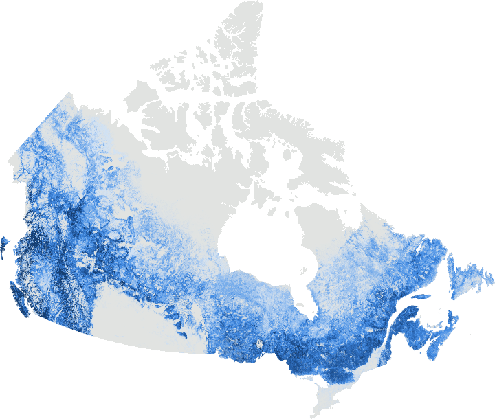
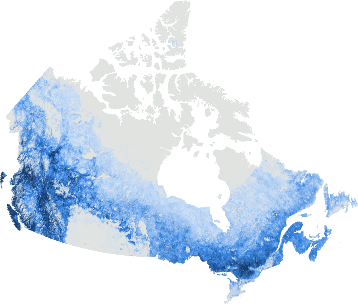
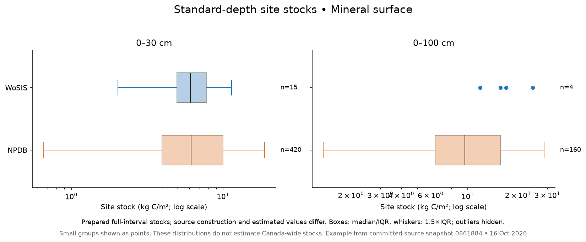
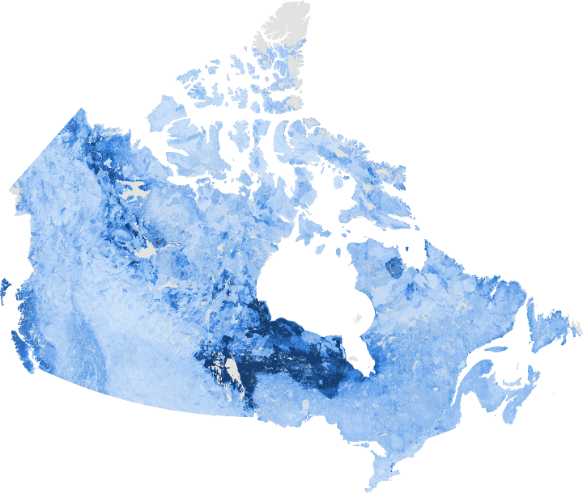

# Data and summaries

Explore what carbon data exist for Canada, where they apply and what they contain. This page summarises each dataset before the [comparisons](comparisons.md).

**Page scaffold:** the example maps and soil-observation figures below come from the existing source snapshot. Panels marked **To add** have not been calculated. Forest plot summaries, independent whole-product value distributions and chosen-area totals remain to be populated. GEE apps will follow separately.

## Page controls to add

- **Domain:** Forests / Soils.
- **Data type:** Ground data / Covariates / Maps.
- **Area:** Canada / province or ecozone / uploaded area of interest.
- **Relevant definitions:** quantity and units; year; depth interval and datum; carbon pool.

These controls define the intended page behaviour. In a first GitHub Markdown version, use section links and static figures. A later website can add linked selectors without duplicating the data summaries.

## Forests

### Ground data

**What the reader should see:** where forest plots and sampled trees are located, which variables they contain, and their observation dates and spatial support.

| Visual | What to show | Status |
|---|---|---|
| Observation map | Locations or appropriately aggregated coverage by dataset; preserve coordinate precision and access restrictions | To add after plot data are available |
| Sampling coverage | Plot records and unique sites by region/ecozone, with dates and repeat visits distinguished | To add |
| Variable availability | Measured tree attributes; biomass/carbon estimates; pool and estimation method | To add |
| Value distributions | Biomass or carbon per unit area by dataset, pool and year; n and units visible | To add |
| Site stocks | Plot-area-normalised carbon stock, with the pool, date and conversion method identified | To add |

The absence of plotted records here is a preparation gap, not evidence that Canadian forest observations do not exist. NFI, Québec permanent plots, ENFOR and other sources remain in the catalogue. Tree-level biomass calibration observations and plot-level stocks need separate summaries.

### Covariates

**What the reader should see:** environmental source layers, their coverage and value distributions, and the forest studies that used them.

- **Map:** selected source variable, with quantity, units, year, source grid and missing-data legend.
- **Distribution:** histogram or cumulative distribution for that same layer and area.
- **Study context:** where the layer was an input, retained predictor or reported importance variable. No generic claim of causation or predictive importance.

Example map: canopy height

**Canopy height, maximum (Sothe covariate)**  
m; mapped from ICESat-2 samples. Preview stretch: 6.13–23.1.

**To add:** additional variable maps and within-area distributions. A covariate's map distribution is distinct from a regression of carbon against that covariate; the latter belongs in the comparisons/analysis section if supported.

### Maps

**What the reader should see:** a product map, a distribution of that product's valid values, and the information needed to interpret both.

Example forest product maps

**McMaster/WWF forest carbon**  
kg C/m² (AGB + BGB + dead plant). Preview stretch: 1.06–9.06.

**SCANFI v1.2 aboveground biomass (2020)**  
t/ha biomass (not carbon). Preview stretch: 2.25–158.

**ESA CCI Biomass v6 AGB (2020)**  
Mg/ha biomass (not carbon); SD band available. Preview stretch: 8.55–231.

**To add:** a value histogram/ECDF for each product in its own valid footprint, plus coverage area, year, pool, units and source uncertainty definition. The map and distribution must describe the same selection. The current previews use separate percentile colour stretches; equal colours do not imply equal values across products.

Keep biomass separate from carbon. A carbon conversion requires a stated, appropriate fraction; a product including roots or dead material must retain that pool definition.

## Soils

### Ground data

#### 1. Where observations exist

**Example snapshot:** national view of the five prepared sources. The map is not a count of independent Canadian sites: cross-border records and shared observations remain in the preparations. Point symbols are rounded for display and overlap at this scale. Final area selections need an explicit geographic filter and a count of excluded records.

#### 2. What they contain and how deep they reach

Depth reach, continuous interval coverage and stock eligibility are separate summaries. A profile extending below 1 m may still have gaps, overlaps or missing density. Availability includes measured or estimated values; missing and unverified values must not be displayed as zero.

**To add alongside the figure:** number of profile records, unique locations where resolvable, sampling dates, coordinate confidence, measured/estimated proportions and exclusions for the selected area. Retain original source flags; do not infer them from numerical values.

#### 3. SOC and bulk density by depth

Show distributions at matching intervals, with the depth datum visible. The example uses two separate preparations rather than pooling them.

Mineral-surface example: SOC and bulk density by depth

WoSIS and NPDB mineral-surface preparations only. Each interval can contain a different set of profiles. These curves summarise groups, not individual-core trajectories.

Profile-surface example: SOC and bulk density by depth

Source-prepared profile-surface datums are retained. Organic-layer treatment and measurement methods differ across sources. Riley density is excluded because its units are unverified.

#### 4. Distribution of observed values

Mineral-surface example: value distributions at 0–5 cm

Profile-surface example: value distributions at 0–5 cm

**To add:** an interval selector, a consistent sample count and an option to inspect individual profiles where permitted. For a selected profile, align SOC, bulk density and cumulative carbon stock against the same depth axis; break the stock curve where required measurements or interval coverage are missing. Keep SOC in g/kg and density in g/cm³, identify log scales, and report any values omitted from log plots. Do not treat repeated layers as independent sites.

#### 5. Site stocks at stated depths

This is carbon per unit area at observed sites, not an area-wide total. Show **0–30 cm**, **0–100 cm** and **full sampled/modelled peat column** separately where supported. Never label a partial sampled column as a complete standard-depth stock.

Mineral-surface example: standard-depth site stock distributions

Profile-surface example: standard-depth site stock distributions

The example stock panels use the source analysis's prepared eligible intervals. They retain source-specific stock construction and measured/estimated limitations. Small groups are shown as points. Outliers are hidden in the example boxplots and sample sizes remain visible; the full distribution must remain available in the final data download.

**To add:** an eligibility flow showing all records → selected area → required measurements → valid continuous interval → stock estimate, with reasons for exclusion. Reconcile layer stock with recorded thickness, depth datum and coarse-fragment handling before treating these preparations as a harmonised stock dataset.

### Covariates

Use the same map + distribution + source information layout as for forests. Candidate families include climate, terrain, vegetation, hydrology, geology and prediction depth. Keep regional coastal variables, such as tidal elevation and sediment fines, linked to their actual observation support.

**To add:** a source-variable map, valid-area coverage, units and period, a histogram/ECDF, and a short table of documented study roles. A 30 m sampling grid does not give coarse climate data 30 m information content.

### Maps

Example soil and peat product maps

**Sothe soil carbon stock**  
kg C/m² (study unit); nominal 0–100 cm; source/import caveats apply. Preview stretch: 7.08–171.

**SoilGrids 2.0 OC stock, 0–30 cm**  
Stored t/ha; ÷10 gives kg/m². Preview stretch: 43–91.

**Geng SOC concentration, 0–5 cm**  
Provider %; import encoding unverified. Preview stretch: 0.626–21.6.

**NCSCDv2 SOC stock, 0–100 cm**  
Source hg C/m² unless converted on import. Preview stretch: 0.603–661.

**Li et al. peat depth, Hudson Bay Lowlands**  
Study cm; encoding unverified. Preview stretch: 77–269.

**Li et al. peat carbon, Hudson Bay Lowlands**  
Study kg C/m²; variable modelled peat column. Preview stretch: 46.5–117.

**PEATGRIDS peat carbon (full peat column)**  
kg C/m²; full modelled peat column. Preview stretch: 90.9–214.

**To add:** product-specific distributions over the selected area's valid pixels, with a depth/pool and year selector where relevant. Keep the following groups separate:

- SOC concentration, **g/kg**.
- Bulk density, **g/cm³**.
- Carbon density, **kg C/m³**.
- Fixed-depth carbon stock, **kg C/m²**, with datum and interval.
- Peat thickness, **cm or m**.
- Full-column peat carbon, **kg C/m²**, with modelled thickness.

The supplied product previews are not full-raster distribution estimates. In particular, paired comparison samples have a shared footprint and should not silently become single-product summaries. Use independent product-wide summaries for this page and common support for the comparisons page.

## Stocks for a chosen area

**To add: an area-of-interest stock summary for both forests and soils.** This panel reports a mapped total over a defined area, separately from observed site stocks.

| Output | Definition | Scaffold status |
|---|---|---|
| Area boundary and size | Chosen polygon and its area in ha or km² | Not selected |
| Product definition | Version, quantity, carbon pool, reference year, depth and datum | Selection required |
| Valid mapped area | Area with valid values, missing area, and percentage coverage | Not calculated |
| Mean stock density | Area-weighted carbon stock per unit area over the valid mapped area | Not calculated |
| Total carbon | Sum of pixel stock density × represented area, reported in tonnes or Tg C | Not calculated |
| Uncertainty | Source-defined uncertainty and an explicit method for aggregation, if supportable | Not calculated |

Report the total as **carbon within the valid mapped area** unless complete area coverage is established. Do not fill missing pixels with zero or scale a partial-coverage total to the whole boundary without a stated method.

### How the total is calculated

For an areal stock in kg C/m², multiply each valid pixel value by the area it represents inside the selected boundary, then sum. Divide kg by **1,000** for tonnes C or by **1,000,000,000** for Tg C. Use appropriate pixel areas and partial-cell boundary weights; do not sum pixel values alone.

Concentration and bulk density are not areal stocks. Deriving a soil stock requires integration through eligible depth intervals, with source-appropriate soil volume and coarse-fragment definitions. A forest plot stock multiplied by its measured plot area gives carbon for that plot, not an estimate for a surrounding landscape.

### Comparing area totals

Link the chosen-area summary to [Comparisons](comparisons.md). Compare products over the **same boundary and common valid area**, with compatible quantities, depth, pool and reference period. Display each product's own coverage separately so a lower total caused by missing coverage is not mistaken for lower carbon.

Show alternative estimates side by side; do not add estimates of the same carbon pool across products. Combining vegetation and soil totals requires explicit non-overlapping pool definitions, aligned area support and a documented treatment of missing data and uncertainty.

## Figure and data checklist

Every published visual should identify: source/version; selected area; quantity and units; depth/datum or carbon pool; time period; observation or map support; sample count or valid mapped area; missing-data treatment; and what uncertainty/shading represents.

For observations, retain profile/site IDs, repeated measurements and shared-source relationships. For maps, record whether distributions are pixel-weighted or area-weighted. A national collection of sampled sites is not an area-representative survey unless its sampling design supports that inference.

## Source and next steps

The example figures use source snapshot [0861884](https://github.com/CathalD/Carbon_Data_SOD/commit/0861884e5414699cac2acab5f08c3ba4464c7490) and its committed prepared interval, location and dataset-summary tables. [Figure source manifest](images/summaries/source_manifest.json) records input hashes and map-preview metadata. No new full-product raster distributions or area totals have been calculated for this scaffold.

1. Confirm the visual layout and default depth/quantity choices.
2. Populate missing forest observations and covariate panels as data become available.
3. Generate independent product distributions and valid-area summaries for a stated area.
4. Add area totals only after the selection, units, depth/pool and masks are explicit.
5. Connect this page to the reviewed comparisons and future GEE app placeholders.
